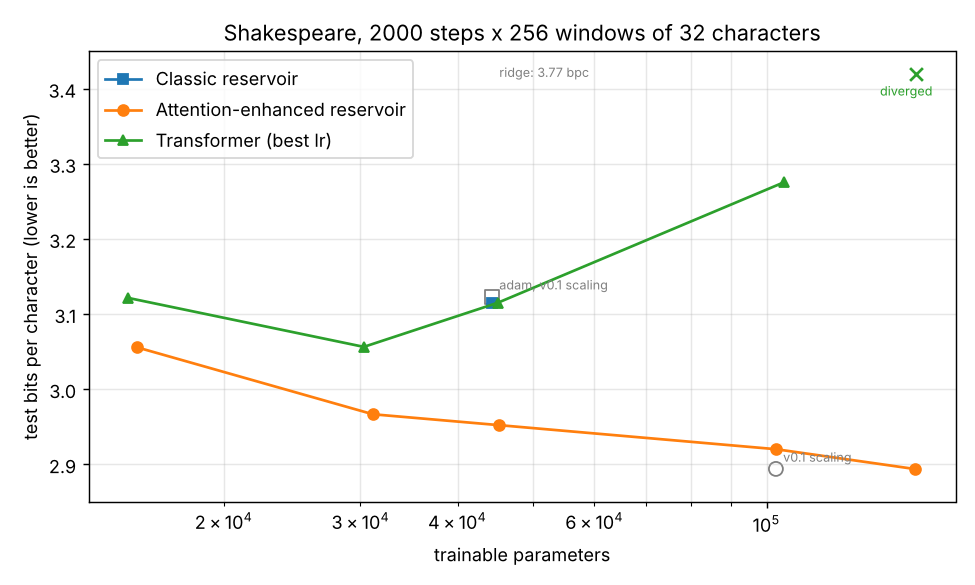

# Shakespeare_Res: reservoirs vs attention-enhanced reservoirs vs Transformers

This repo compares three small next-character models on the complete works of Shakespeare (9M characters, lowercased, 59-symbol vocabulary). Each model reads a window of 32 characters and predicts the next one:

| model | what is trained | idea |
|---|---|---|
| **Classic reservoir** (`models/reservoir.py`) | linear readout only | fixed random tanh reservoir, $s_t = \tanh(s_{t-1}R + e_t W_{in})$, then LayerNorm and a linear classifier |
| **Attention-enhanced reservoir** (`models/att_reservoir.py`) | readout network only | the same frozen reservoir, but the readout weights are *generated from the reservoir state itself*: $h = W(r)\,r$ with $W(r) = \mathrm{MLP}(r)$, then a linear classifier |
| **Transformer** (`models/transformer.py`) | everything | `nn.TransformerEncoder` over the window, reading out the last position |

The question is how far a frozen reservoir gets when its readout is allowed to be input-dependent, as an "attention" over reservoir features. This is the idea behind [AERes](https://github.com/fekoester/AERes) and [LAERC](https://github.com/fekoester/LAERC).

## Results

Setup:
- the original sweep configurations, run on 2 CPU cores
- 2,000 Adam steps × 256 windows, the same learning rate (3e-3) for every model
- the best epoch is chosen on a validation split, and the test split is the last 10% of the corpus (200k test windows)

Reproduce with `python benchmark.py`.



| model | config | trainable params | test bpc ↓ | test accuracy | train time |
|---|---|---|---|---|---|
| Classic reservoir | R=750 | 44,309 | 3.114 | 37.9% | 2.9 min |
| Classic reservoir, ridge readout | R=750 | 44,309 | 3.772 | **38.9%** | 5.2 min |
| Attention-enhanced reservoir | R=75, H=13 | 15,464 | 3.056 | 37.6% | 0.2 min |
| Attention-enhanced reservoir | R=75, H=19 | 31,124 | 2.967 | 39.1% | 0.2 min |
| Attention-enhanced reservoir | R=100, H=20 | 45,259 | 2.952 | 39.1% | 0.2 min |
| Attention-enhanced reservoir | R=150, H=25 | 102,809 | 2.920 | 39.6% | 0.4 min |
| **Attention-enhanced reservoir** | R=160, H=30 | 155,459 | **2.894** | **40.6%** | 0.4 min |
| Transformer | L=4, heads=4, ffn=64 | 15,067 | 3.122 | 36.3% | 4.1 min |
| Transformer | L=8, heads=8, ffn=72 | 30,299 | 3.056 | 37.5% | 12.6 min |
| Transformer | L=8, heads=8, ffn=128 | 45,083 | 3.115 (3.253 at lr 1e-3) | 35.9% | 14.2 min |
| Transformer | L=8, heads=8, ffn=356 | 105,275 | diverged (3.276 at lr 1e-3) | – | 20.4 min |
| Transformer | L=16, heads=16, ffn=256 | 155,803 | diverged (also at lr 1e-3) | – | 57 min |

What this says:

- **The attention-enhanced reservoir wins at every size.** It has the lowest bits per character for a given parameter count. With 15k parameters it matches the 30k-parameter Transformer, and its training takes seconds rather than minutes, because only the readout network gets gradients.
- **An input-dependent readout beats a bigger linear one.** At 45k parameters the attention-enhanced reservoir (R=100) reaches 2.95 bpc, against 3.11 for the classic reservoir (R=750) and 3.12 for the Transformer.
- **The deeper Transformers did not train under this budget.** They use post-LayerNorm layers, have no warmup, and their heads are tiny (embedding 16 split into 8–16 heads of size 1–2). At lr 3e-3 the two largest collapse to predicting character frequencies. At lr 1e-3 the 8-layer ones train, but more slowly than at 3e-3, and the 16-layer one still collapses. The plot shows the better of the two learning rates for each Transformer. Their numbers are a statement about this short CPU budget, not about Transformers in general.
- **The ridge readout has the best accuracy of the classic reservoir runs but poor bpc.** Least squares on one-hot targets ranks the right character well but gives badly calibrated probabilities, even after fitting a temperature on validation data.
- All of these are tiny models with a 32-character context and a few minutes of CPU training. Good character-level models reach 1.3–2 bpc on this kind of data.

### Spectral radius

v0.1 divided the reservoir matrices by 0.9 instead of multiplying, so the spectral radius was **≈1.13**, not 0.9. The radius is now set exactly with `--spectral_radius` (default 0.9), and `--legacy_scaling` reproduces the old weights bit for bit. The old value turns out to be a good one. In the sweep below (attention-enhanced reservoir, R=150, H=25), the optimum sits around ρ ≈ 1.1 (2.896 bpc), compared with 2.920 at 0.9, 3.067 at 0.5 and 2.994 at 1.6. The v0.1 run lands at 2.894. With only 32 steps per window and a LayerNorm after the reservoir, the model doesn't need the echo-state property; a slightly supercritical, more strongly nonlinear reservoir simply works a bit better here. The default stays at the conventional 0.9; use `--spectral_radius 1.1` for the best value found here.


### Samples

Generated with `generate.py --prompt "romeo: " --temperature 0.7`, after 2,000 training steps:

```text
attention-enhanced reservoir (R=160, H=30):
romeo: them  see;
as to maling would her but  to be a const soldee so so to man'tis shor thou for me have dor be lase,  thee.
for not were  of beath ent of siresarly wasture to stup us ball?

transformer (L=8, ffn=72):
romeo: ieoey eeeyuieeeeoo,
[eues the he her sorders a comer sord besons,
to bing so sherundomer that nous and and biest that firer
```

## Usage

```bash
pip install -r requirements.txt          # torch, numpy, tqdm, matplotlib

python train.py --model att_reservoir --res 150 --hid 25 --epochs 5
python train.py --model reservoir --res 750 --readout ridge         # closed-form readout, one pass
python train.py --model transformer --hid 128 --heads 8 --layers 8 --lr 1e-3
python generate.py checkpoints/<run>/model.pt --prompt "to be, or not to be" --length 400

python train_att_reservoir.py            # the original sweeps (extra flags are passed through)
python train_transformer.py
python train_reservoir.py --legacy_scaling
python benchmark.py                      # everything in the Results section
```

`train.py --help` lists all options. The main ones:

| group | flags |
|---|---|
| model | `--model`, `--seq`, `--emb`, `--res`, `--hid`, `--heads`, `--layers` |
| reservoir | `--spectral_radius`, `--input_scale`, `--legacy_scaling`, `--readout {adam,ridge}` |
| training | `--epochs`, `--steps_per_epoch`, `--batch`, `--lr`, `--eval_windows`, `--test_windows`, `--seed` |
| data | `--data`, `--no_lowercase` |

Each run writes `checkpoints/<name>/model.pt` (weights, config and vocabulary) and `metrics.json` (per-epoch validation bpc and accuracy, test bpc and accuracy, trainable parameters).

**Data splits** are contiguous. Test is the last 10% of the corpus, as in v0.1. Validation is the 5% just before it, and the epoch with the best validation loss is the one evaluated on test.

## Changes in 0.2

- **Reservoir scaling:**
  - the spectral radius is now set exactly; it used to be ≈1.13 by accident
  - `--legacy_scaling` reproduces v0.1, checked against the original code by a test
  - `--input_scale` is new
- **Correct parameter counts:** the extractor's LayerNorm was counted as trainable but never optimised. It is now frozen explicitly, which changes nothing in the outputs.
- **Mixed precision:** bf16 autocast only on CUDA, where it used to be switched on on CPU too. The deprecated `torch.cuda.amp.GradScaler` is gone.
- **Faster data:** the corpus is encoded once and windows are sliced from a tensor. There is no more per-character Python work for each sample, and the reservoir input projection runs for all steps at once.
- **One CLI** (`train.py`) with:
  - a validation split
  - bits per character and accuracy
  - checkpoints that carry their config and vocabulary
  - a ridge readout option

  The three original scripts are now thin wrappers that run the v0.1 sweeps.
- **New scripts:** `generate.py` for sampling, and `benchmark.py` for the parameter-matched comparison and the spectral-radius sweep.
- **Housekeeping:** tests, CI and pyproject. The README no longer lists a CONTRIBUTING.md that didn't exist, and the LICENSE has a real name.
