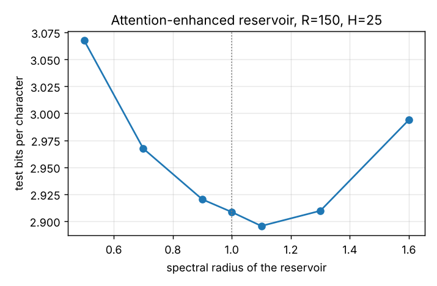

# Shakespeare_Res: reservoirs vs attention-enhanced reservoirs vs Transformers

This repo compares three small next-character models on the complete works of Shakespeare (9M characters, lowercased, 59-symbol vocabulary). Each model reads a window of 32 characters and predicts the next one:

| model | what is trained | idea |
|---|---|---|
| **Classic reservoir** (`models/reservoir.py`) | linear readout only | fixed random tanh reservoir, $s_t = \tanh(s_{t-1}R + e_t W_{in})$, then LayerNorm and a linear classifier |
| **Attention-enhanced reservoir** (`models/att_reservoir.py`) | readout network only | the same frozen reservoir, but the readout weights are *generated from the reservoir state itself*: $h = W(r)\,r$ with $W(r) = \mathrm{MLP}(r)$, then a linear classifier |
| **Transformer** (`models/transformer.py`) | everything | `nn.TransformerEncoder` over the window, reading out the last position |

The question is how far a frozen reservoir gets when its readout is allowed to be input-dependent, as an "attention" over reservoir features. This is the idea behind [AERes](https://github.com/fekoester/AERes) and [LAERC](https://github.com/fekoester/LAERC).

## Results

### Reference: the paper

The full comparison is in Köster & Uchida, *Reservoir computing as a language model*, [Phys. Rev. Applied **26**, 024051 (2026)](https://doi.org/10.1103/sd11-x3ny) ([arXiv:2507.15779](https://arxiv.org/abs/2507.15779)). It used:
- the lowercased corpus in 6 contiguous shards, 5 for training and 1 for testing
- 5 passes over each shard before moving to the next
- Adam at lr 1e-4, batch 1,024, embedding size 16 for all models
- an RTX 4090 with mixed precision

Final test cross-entropy (PyTorch's nats; bits per character in brackets):

| model | test loss |
|---|---|
| Transformer, largest configuration | **1.67** (≈2.41 bpc) |
| Attention-enhanced reservoir | 1.73 (≈2.50 bpc) |
| Classic reservoir | 1.81 (≈2.61 bpc) |

Trained properly, the Transformer predicts best. The attention-enhanced reservoir comes close at a fraction of the training cost, and both reservoir models overfit more than the Transformer.

Reproduce it with the paper's protocol (needs a GPU for the large Transformers):

```bash
python benchmark.py --protocol paper --out results/paper
# or a single model:
python train.py --protocol paper --model att_reservoir --res 160 --hid 30
```

### Quick CPU check (not converged)

`results/quick/` holds a short sanity run from 2 CPU cores:
- 2,000 steps × 256 windows, about 1.4% of one pass of the paper's schedule
- lr 3e-3, i.e. 30× the paper's
- reproduce with `python benchmark.py --protocol quick --out results/quick`

It is useful for checking that everything runs and for comparing reservoir settings with each other. **It is not a fair comparison with the Transformers**, for two reasons:

- **Nothing is converged.** Every model ends at 2.89–3.12 bpc, far above the paper's 2.4–2.6.
- **The deeper post-LN Transformers fail to train at this learning rate.** With 8–16 post-LayerNorm layers, no warmup and heads of size 1–2 (embedding 16 split into 8–16 heads), the large configurations get stuck predicting only the character frequencies (4.41 bpc). That is an optimisation failure at lr 3e-3, not a property of the model; at the paper's lr 1e-4 they train. `--norm_first` (pre-LN) and `--warmup_steps` are available for experiments beyond the paper's setup.

| model | config | trainable params | test bpc (quick check) |
|---|---|---|---|
| Classic reservoir | R=750 | 44,309 | 3.114 |
| Classic reservoir, ridge readout | R=750 | 44,309 | 3.772 |
| Attention-enhanced reservoir | R=75, H=13 | 15,464 | 3.056 |
| Attention-enhanced reservoir | R=100, H=20 | 45,259 | 2.952 |
| Attention-enhanced reservoir | R=160, H=30 | 155,459 | 2.894 |
| Transformer | L=4, heads=4, ffn=64 | 15,067 | 3.122 |
| Transformer | L=8, heads=8, ffn=72 | 30,299 | 3.056 |
| Transformer | L=8, heads=8, ffn=128 | 45,083 | 3.115 |
| Transformer | L=8, heads=8, ffn=356 / L=16, heads=16, ffn=256 | 105k / 156k | failed to train at this lr |

The full table, including the v0.1-scaling and lr 1e-3 runs, is in `results/quick/benchmark.md`.

Two observations from the quick check hold regardless of budget, because they compare reservoir settings with each other:

- **The closed-form ridge readout** has the best accuracy among the classic reservoir runs (38.9%) but poor bpc. Least squares on one-hot targets gives badly calibrated probabilities, even after fitting a temperature on validation data.
- **The spectral radius.** v0.1 divided the reservoir matrices by 0.9 instead of multiplying, so the spectral radius was **≈1.13**, not 0.9. The radius is now set exactly with `--spectral_radius` (default 0.9), and `--legacy_scaling` reproduces the old weights bit for bit. The old value is a good one. In the sweep below (attention-enhanced reservoir, R=150, H=25, quick check), the optimum sits around ρ ≈ 1.1 (2.896 bpc), against 2.920 at 0.9, 3.067 at 0.5 and 2.994 at 1.6. Under the paper's longer training this optimum may shift.



### Multi-timescale reservoir

As in [LAERC](https://github.com/fekoester/LAERC), the reservoir can have a spectrum of timescales. With `--leak_min a_min < 1`, each unit *i* integrates with its own leak rate $a_i$, log-spaced in $[a_\min, 1]$:

$$
s_t = s_{t-1} + a \odot \big(\tanh(s_{t-1}R + e_t W_{in}) - s_{t-1}\big)
$$

The fastest units forget within a character and the slowest remember about $1/a_\min$ characters. The random weights are the same as without leak. `benchmark.py` includes multi-timescale variants (`--leak_min 0.1`) of the classic reservoir (R=750) and the attention-enhanced reservoir (R=150, H=25); they have not been run yet.

## Usage

```bash
pip install -r requirements.txt          # torch, numpy, tqdm, matplotlib

python train.py --model att_reservoir --res 150 --hid 25 --epochs 5        # v0.1 setup (lr 1e-4, batch 1024)
python train.py --protocol paper --model att_reservoir --res 150 --hid 25  # the paper's shard schedule
python train.py --model att_reservoir --res 150 --hid 25 --leak_min 0.1   # multi-timescale reservoir
python train.py --model reservoir --res 750 --readout ridge         # closed-form readout, one pass
python train.py --model transformer --hid 128 --heads 8 --layers 8
python generate.py checkpoints/<run>/model.pt --prompt "to be, or not to be" --length 400

python train_att_reservoir.py            # the original sweeps (extra flags are passed through)
python train_transformer.py
python train_reservoir.py --legacy_scaling
python benchmark.py --protocol paper     # the paper comparison (GPU recommended)
python benchmark.py --protocol quick --out results/quick   # the CPU sanity check
```

`train.py --help` lists all options. The main ones:

| group | flags |
|---|---|
| model | `--model`, `--seq`, `--emb`, `--res`, `--hid`, `--heads`, `--layers`, `--dropout`, `--norm_first` |
| reservoir | `--spectral_radius`, `--input_scale`, `--legacy_scaling`, `--leak_min`, `--readout {adam,ridge}` |
| training | `--epochs`, `--steps_per_epoch`, `--batch`, `--lr`, `--warmup_steps`, `--eval_windows`, `--test_windows`, `--seed` |
| schedule and splits | `--protocol paper`, `--shards`, `--shard_epochs`, `--test_frac`, `--val_frac` |
| data | `--data`, `--no_lowercase` |

Each run writes `checkpoints/<name>/model.pt` (weights, config and vocabulary) and `metrics.json` (per-epoch validation bpc and accuracy, test bpc and accuracy, trainable parameters).

**Data splits** are contiguous. By default, test is the last 10% of the corpus, as in v0.1, and validation is the 5% just before it; the epoch with the best validation loss is the one evaluated on test. `--protocol paper` uses the last sixth for testing, no validation split, and 5 training shards with 5 passes each.

## Changes in 0.2

- **Reservoir scaling:**
  - the spectral radius is now set exactly; it used to be ≈1.13 by accident
  - `--legacy_scaling` reproduces v0.1, checked against the original code by a test
  - `--input_scale` is new
- **Correct parameter counts:** the extractor's LayerNorm was counted as trainable but never optimised. It is now frozen explicitly, which changes nothing in the outputs.
- **Mixed precision:** bf16 autocast only on CUDA, where it used to be switched on on CPU too. The deprecated `torch.cuda.amp.GradScaler` is gone.
- **Faster data:** the corpus is encoded once and windows are sliced from a tensor. There is no more per-character Python work for each sample, and the reservoir input projection runs for all steps at once.
- **One CLI** (`train.py`) with:
  - a validation split
  - bits per character and accuracy
  - checkpoints that carry their config and vocabulary
  - a ridge readout option

  The three original scripts are now thin wrappers that run the v0.1 sweeps.
- **The paper's protocol:** `--protocol paper` and the `--shards` / `--shard_epochs` schedule.
- **Multi-timescale reservoir** (`--leak_min`), as in LAERC.
- **Transformer options:** `--norm_first`, `--dropout` and `--warmup_steps`. The defaults are unchanged.
- **New scripts:** `generate.py` for sampling, and `benchmark.py` for the parameter-matched comparison (paper protocol or a quick CPU check) and the spectral-radius sweep.
- **Housekeeping:** tests, CI and pyproject. The README no longer lists a CONTRIBUTING.md that didn't exist, and the LICENSE has a real name.
